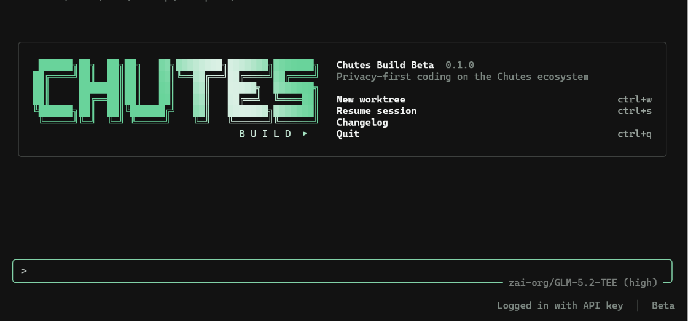

# Chutes Build

A Chutes-native terminal coding agent

[](https://github.com/TheStreamCode/chutes-build/actions/workflows/ci.yml)
[](https://www.npmjs.com/package/chutes-build)
[](LICENSE)



Chutes Build is a terminal-based AI coding agent for the [Chutes](https://chutes.ai) ecosystem. It runs as a full-screen TUI (terminal user interface) that understands a codebase, edits files, executes shell commands, searches the web, and manages long-running tasks, interactively, headlessly for scripts and CI, or embedded in editors through the Agent Client Protocol (ACP). It is an independent, unofficial fork of [xai-org/grok-build](https://github.com/xai-org/grok-build) with Chutes-native inference, model routing, media and account endpoints, and it is not affiliated with or endorsed by xAI.

## Contents

- [Install](#install)
- [Quick start](#quick-start)
- [Features](#features)
- [Requirements](#requirements)
- [Configuration](#configuration)
- [Privacy and security](#privacy-and-security)
- [Troubleshooting](#troubleshooting)
- [Development](#development)
- [Support](#support)
- [Contributing](#contributing)
- [License](#license)

## Install

Install the npm launcher, which resolves the native binary for the current platform:

```sh
npm install -g chutes-build
chutes-build --version
```

Run it once without installing:

```sh
npx chutes-build
```

Each release also publishes the six platform executables (macOS, Linux and Windows, x64 and arm64) as downloadable assets on the [releases page](https://github.com/TheStreamCode/chutes-build/releases). Older releases carry release notes only, so use npm for those.

There is no self-update: `chutes-build` never contacts an update server, and the `update` subcommand reports where to get a newer version instead of fetching one. [`CHANGELOG.md`](CHANGELOG.md) records what changed in each release.

## Quick start

1. Create a Chutes API key at [chutes.ai/app/settings/api-keys](https://chutes.ai/app/settings/api-keys).
2. Provide the key once with `chutes-build login`, paste it on the welcome screen, or export `CHUTES_API_KEY` for the current process. An explicit environment key wins over a saved one.
3. Run `chutes-build` from the repository you want the agent to inspect. Start with `/help`, `/model` and `/docs`.

```sh
chutes-build login
cd path/to/your/repository
chutes-build
```

Headless runs use the same binary:

```sh
chutes-build -p "Summarize this repository" --output-format plain
chutes-build -p "Return the package list" --output-format json
```

Headless-only controls such as `--max-turns`, `--tools`, `--disallowed-tools` and `--json-schema` require a headless prompt.

Full documentation lives in the repository: the [documentation hub](docs/README.md) links the [getting started guide](docs/getting-started.md), [configuration reference](docs/configuration.md), CLI reference and slash-command reference. The in-binary user guide at [`crates/codegen/xai-grok-pager/docs/user-guide/`](crates/codegen/xai-grok-pager/docs/user-guide/README.md) covers keyboard shortcuts, theming, MCP servers, skills, plugins, hooks, sessions, sandboxing, headless mode and more. There is no separate documentation site.

## Features

- Chutes-native inference and routing: requests go to Chutes, the model catalog is Chutes', and the default route is Chutes' native routing, either the saved `default` pool or an inline pool set with `CHUTES_ROUTING_POOL`.
- Automatic equivalent-model fallback when a chute is unavailable, with an ordered `CHUTES_FALLBACK_MODELS` chain and `CHUTES_STRICT_MODEL=1` to disable it.
- Full-screen TUI with file edits, shell commands, code search, plan mode, rewind and undo, sessions, and long-running background tasks.
- Headless mode for scripts and CI, plus the Agent Client Protocol (ACP) for editor integrations.
- Chutes ecosystem tools the agent calls on its own: image generation and editing, video and music generation, speech-to-text and text-to-speech, PDF and document extraction, OCR, text embeddings, and Context7 documentation lookup.
- Isolated browser automation over the DevTools protocol, with a temporary profile and loopback-only DevTools, plus automatic vision delegation for text-only models.
- Privacy boundaries compiled in rather than configured out: telemetry, remote error reporting, upload, session sharing, remote workspace exposure and self-update are disabled at build time and their endpoints are deadened. See [`PRIVACY.md`](PRIVACY.md).
- Permission prompts, a sandbox, local memory, MCP servers, skills, plugins and hooks, documented in the user guide.

## Requirements

- Windows, macOS or Linux, on x64 or arm64.
- Node.js 18 or newer for the npm launcher.
- A Chutes API key. It is the only credential; there is no browser login.
- For a source build: Git, a Rust toolchain (pinned in [`rust-toolchain.toml`](rust-toolchain.toml), installed automatically by `rustup`), and the platform C/C++ toolchain used by Rust.
- [DotSlash](https://dotslash-cli.com) on `PATH` before building, so hermetic tools under [`bin/`](bin/) such as [`bin/protoc`](bin/protoc) can run.
- `protoc` for proto code generation, resolved through DotSlash or a `protoc` on `PATH` or in `$PROTOC`. On Windows use the vendored `protoc` fallback, because the DotSlash wrapper in `bin/protoc` is not executable from a build script there.

## Configuration

Configuration layers command-line arguments, environment variables, user configuration, project configuration and project instructions. `chutes-build inspect --json` shows the effective non-secret structure, and [`docs/configuration.md`](docs/configuration.md) is the full reference.

| Setting | Purpose | Default |
| --- | --- | --- |
| `CHUTES_API_KEY` | Ambient Chutes API credential, sent only to allowlisted official HTTPS endpoints | Unset; prompted or saved by `chutes-build login` |
| `CHUTES_BUILD_HOME` | Relocates the complete user state tree, including credentials, sessions, logs and plugins | `~/.chutes-build` |
| `CHUTES_BUILD_DEFAULT_MODEL` | Default model id, or a native routing string such as `default` or an inline pool | Chutes native routing (`default`) |
| `CHUTES_ROUTING_POOL` | Inline routing pool of comma-separated catalogue ids | Unset |
| `CHUTES_ROUTING_STRATEGY` | Routing strategy for a pool: `sequential`, `latency` or `throughput` | `sequential` |
| `CHUTES_FALLBACK_MODELS` | Ordered comma-separated fallback chain | Unset |
| `CHUTES_STRICT_MODEL` | Set to `1` to disable automatic fallback | Disabled |
| `CHUTES_EXTRA_CA_BUNDLE` | PEM bundle of extra TLS roots for networks that intercept TLS | Unset; no file is read |

Environment variables are read from the process environment; `.env` files are not loaded automatically. Endpoint overrides fail closed unless they use an allowlisted Chutes HTTPS host with no URL credentials and the default port, and ambient credentials are never inherited by arbitrary custom endpoints.

## Privacy and security

Sessions, memory, configuration, logs, traces and generated artifacts stay local unless a documented feature needs a provider request. Telemetry, remote error reporting, trace upload, session sharing, remote workspace exposure, managed remote configuration and automatic updates stay off regardless of inherited configuration values. [`PRIVACY.md`](PRIVACY.md) is the authoritative statement of the data boundaries.

Report vulnerabilities privately through [`SECURITY.md`](SECURITY.md), never in a public issue.

## Troubleshooting

### Missing `CHUTES_API_KEY`

On first launch Chutes Build asks for a key created at [chutes.ai/app/settings/api-keys](https://chutes.ai/app/settings/api-keys); it also reads `CHUTES_API_KEY` from the process environment. If requests fail with authentication errors, check that the variable is exported in the launching shell: `.env` files are not loaded automatically. Never commit a real key; use your shell, your CI platform or a secret manager, and run `chutes-build inspect --json` to verify the effective non-secret configuration.

### Model-pool routing errors

The default route is Chutes' native routing: the saved `default` pool (managed at chutes.ai/app, Model Routing) or an inline pool from `CHUTES_ROUTING_POOL`. When the `default` alias cannot resolve and no dashboard pool is saved, the built-in fallback chain steps down to a live inline pool from the current catalogue; a saved dashboard pool takes priority once configured. Check the saved pool, set `CHUTES_ROUTING_POOL` explicitly, review `CHUTES_FALLBACK_MODELS` ordering, and pick a strategy with `CHUTES_ROUTING_STRATEGY`.

### Windows console shows wrong glyphs

The TUI degrades decorative glyphs on the legacy Windows console: arrows, checkmarks, diamonds and spinners fall back to ASCII or CP437-safe stand-ins. This is expected on legacy ConHost; for full rendering use Windows Terminal, the VS Code terminal or another modern emulator.

### Browser or media tools unavailable

Browser automation needs Chrome or Edge, or an explicit `CHUTES_BROWSER_EXECUTABLE`. Video inspection needs FFmpeg, or an explicit `CHUTES_FFMPEG_EXECUTABLE`; install it and restart the process.

## Development

Clone the repository and build with the pinned toolchain:

```sh
git clone https://github.com/TheStreamCode/chutes-build.git
cd chutes-build
cargo run -p chutes-build              # build and launch the TUI
cargo build -p chutes-build --release  # release binary: target/release/chutes-build
cargo check --workspace                # fast validation
```

Run checks on the crates you touched instead of the whole workspace:

```sh
cargo test -p xai-grok-config   # per-crate tests
cargo clippy -p <crate>         # lint configuration: clippy.toml at the repository root
```

The binary artifact is named `chutes-build`. The root `Cargo.toml` is generated and read-only: change the owning crate manifest or the generator source, and prefer per-crate `Cargo.toml` files. `Cargo.lock` is committed, and the npm launcher is a thin resolver for prebuilt native binaries: it never compiles Rust and has no install lifecycle script.

### Repository layout

| Path | Contents |
| --- | --- |
| `crates/chutes-build-core` | Chutes-owned product policy and integrations |
| `crates/codegen/xai-grok-pager-bin` | Composition-root package `chutes-build`; builds the binary |
| `crates/codegen/xai-grok-pager` | The TUI: scrollback, prompt, modals, rendering |
| `crates/codegen/xai-grok-shell` | Agent runtime and leader, stdio and headless entry points |
| `crates/codegen/xai-grok-tools` | Tool implementations (terminal, file edit, search, media, browser) |
| `crates/codegen/xai-grok-workspace` | Host filesystem, VCS, execution and checkpoints |
| `crates/codegen/...` | The rest of the CLI crate closure (config, MCP, markdown, sandbox) |
| `third_party/` | Vendored upstream source, including the Mermaid diagram stack |

## Support

See [`SUPPORT.md`](SUPPORT.md) and GitHub Discussions for usage questions. Bug reports belong in GitHub Issues; security problems follow [`SECURITY.md`](SECURITY.md) and never a public issue.

## Contributing

External contributions are not accepted. See [`CONTRIBUTING.md`](CONTRIBUTING.md) for the licensing terms that apply to this source.

## License

First-party code in this repository is licensed under the **Apache License, Version 2.0**; see [`LICENSE`](LICENSE). The project is derived from `xai-org/grok-build`, used under Apache-2.0; the upstream attribution is preserved in [`NOTICE`](NOTICE).

Third-party and vendored code remains under its original licenses:

- [`THIRD-PARTY-NOTICES`](THIRD-PARTY-NOTICES) lists crates.io and git dependencies, bundled UI themes, and in-tree source ports, including the openai/codex and sst/opencode tool implementations.
- [`crates/codegen/xai-grok-tools/THIRD_PARTY_NOTICES.md`](crates/codegen/xai-grok-tools/THIRD_PARTY_NOTICES.md) is the crate-local notice for the codex and opencode ports, with license texts and the Apache section 4(b) change notice.
- [`third_party/NOTICE`](third_party/NOTICE) is the vendored Mermaid-stack index.

---

Maintained by [Michael Gasperini (Mikesoft)](https://mikesoft.it).
If this project is useful to you, consider [sponsoring its maintenance](https://github.com/sponsors/TheStreamCode).
